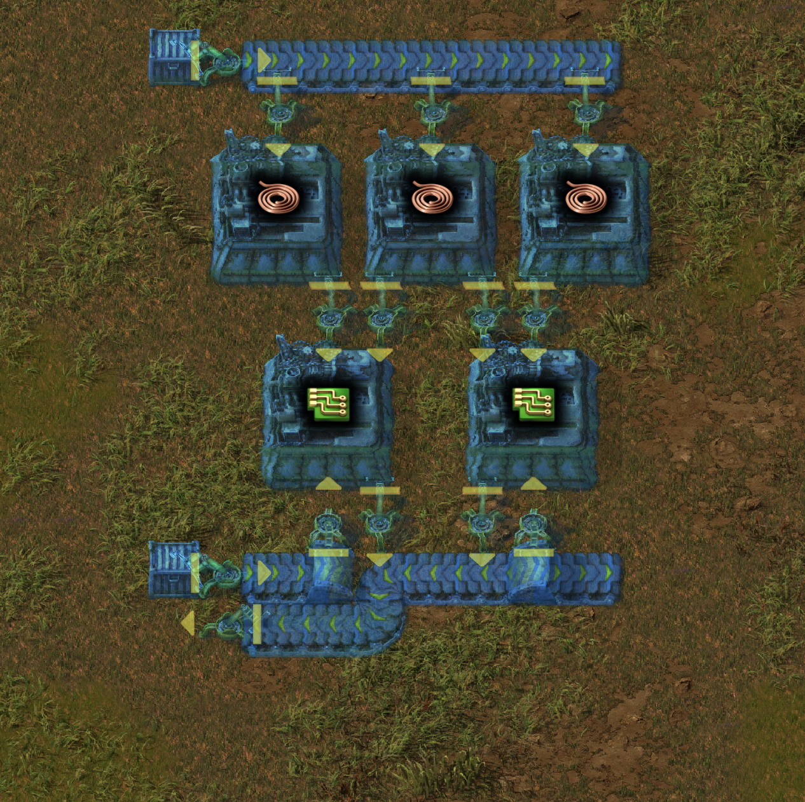
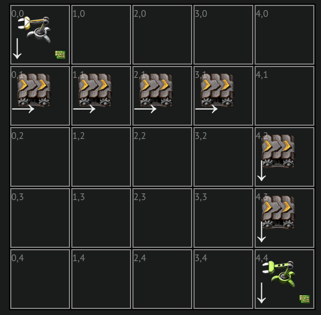
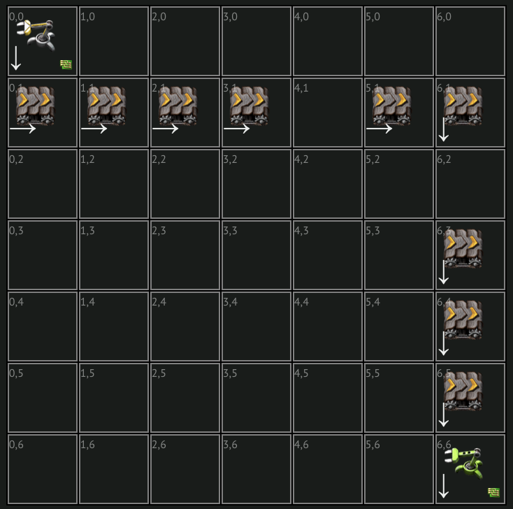
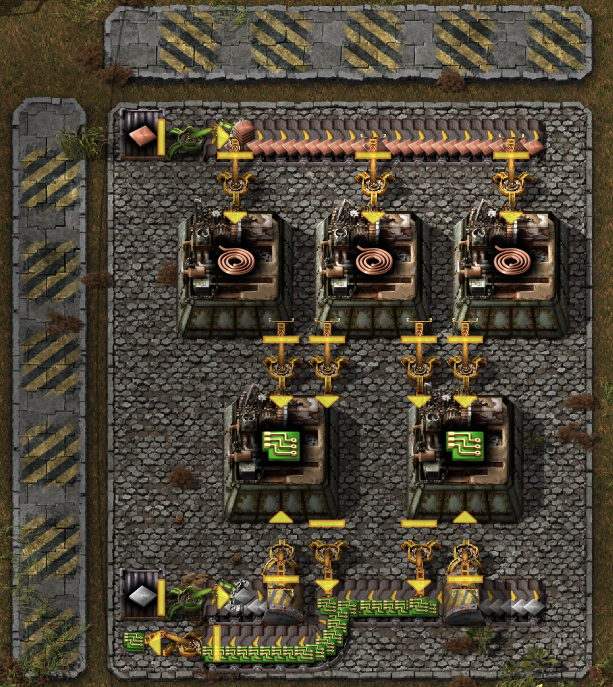
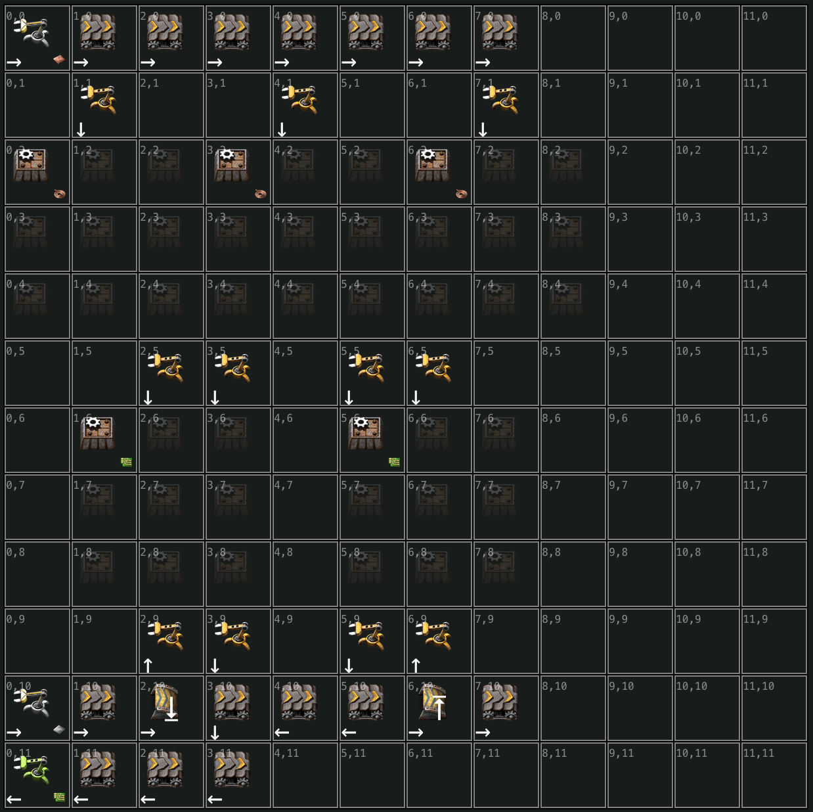
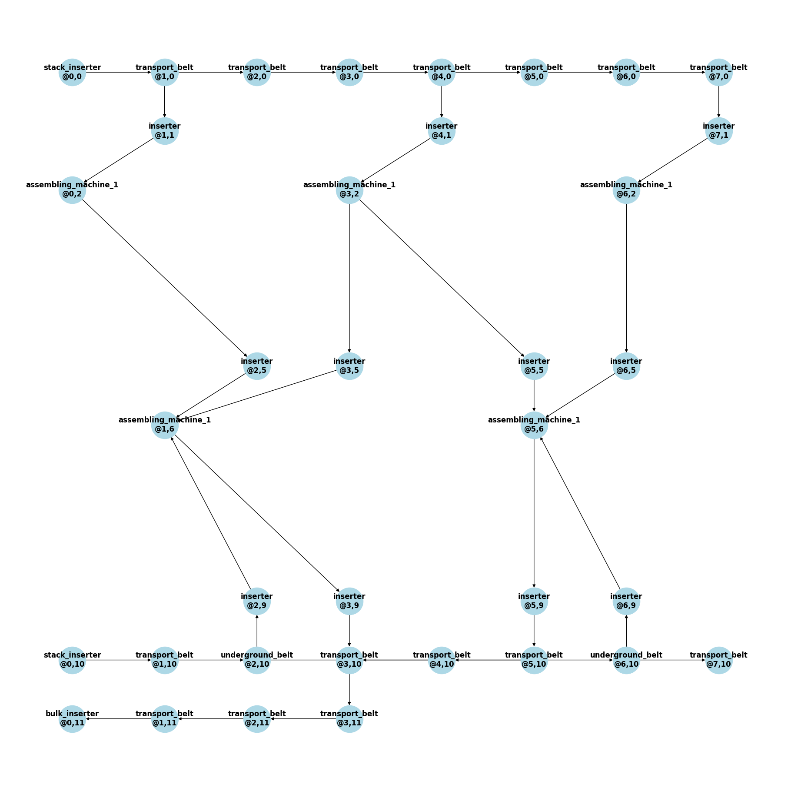

# Factorion: An RL Agent for Building Factories

This project is an experiment in using Reinforcement Learning (RL) to train an
agent that can build high-throughput factories in an environment inspired by
the game Factorio.

The ultimate goal is to create an agent that, given a defined buildable area, a
"source" tile for inputs, and a "sink" tile for outputs, can autonomously
design and build a factory. This involves placing all the necessary assembling
machines, power poles, transport belts, etc. to transform the input items into
the desired output items, optimising for maximum production throughput of the
output items.

> **Note:** This project is under heavy development. The codebase is
> experimental and will not be held to the same quality standards as my more
> mature projects (e.g., https://github.com/beyarkay/eskom-calendar).



Weights & Biases report (long out of date, 2025-04-29; current work has
progressed significantly): https://api.wandb.ai/links/beyarkay/wmccb7fq

## Where things stand

The pipeline is denoising pretraining (SFT) followed by RL finetuning, on a
15×15 grid. Headline numbers are in W&B project `beyarkay/factorion`.

- **RL lifts the SFT base.** From SFT base `dr17bmik`, RL took held-out
  `eval/thput@8` from 1.32 to 1.41 over 20M steps
  ([#484](https://github.com/beyarkay/factorion/pull/484)); above 1 means the
  model out-produces the generator's reference factory.
- **Building from markers alone is still the open problem.** The `TRIAL_*`
  kinds hand the model nothing but source and sink markers — no reference
  solution to imitate, and one source per ingredient of the target recipe.
  This is the number that actually matters.

## What is Factorio?

Factorio is a popular 2D tile-based top-down PC game centred on automation and
logistics. Players start by manually mining basic resources like iron and
copper ore. They then use these resources to build machines, which in turn
automate production processes. The core gameplay loop involves designing and
expanding intricate "factories" - complex webs of machines, conveyor belts, and
robotic arms - to produce increasingly sophisticated items, from simple gears to
rocket components. The game presents a significant logistical and design
challenge, making it an interesting domain for an autonomous RL agent.

## The Reinforcement Learning Problem

Instead of integrating directly with the game (which would be prohibitively
slow for training), this project uses a basic implementation of core Factorio
mechanics. The throughput simulation and the lesson generators live in a Rust
extension (`factorion_rs/`, built with PyO3/maturin); the simulator runs
21,000–76,000 factories/second and is no longer the training bottleneck.

### The world

A factory is a grid where each cell `(x, y)` has several channels describing
its contents, a tensor of shape `(Channels, Width, Height)`:

- `ENTITIES`: An integer ID for the machine or belt in that cell (e.g.,
  transport belt, assembler).
- `DIRECTION`: The orientation of the entity (e.g., North, East, South,
  West).
- `ITEMS`: The recipe an assembler is set to.
- `MISC`: Whether an underground belt is an entrance or an exit.
- `FOOTPRINT`: Whether the cell is buildable at all.

A task is a grid holding only source and sink markers (plus any walls); the
model fills in every other tile at once. The result is scored by simulating
the flow of items through the constructed belts and machines to get the
factory's **throughput** (items produced per second), divided by the
generator's reference throughput for that task and discounted by the
factory's entity cost, so the model cannot buy throughput with unlimited
entities.

#### An example 5x5 environment with one transport-belt missing



#### An example 7x7 environment with two transport-belts missing



### Training pipeline: SFT pretraining, then RL finetuning

The project uses an LLM-style pipeline — generate data, pretrain on it, then
finetune with RL:

**Stage 1 — Data generation via lessons.** Hand-written factory generators
(`build_factory()`, implemented in `factorion_rs/src/factory_gen.rs`) produce
known-correct factories. Each **lesson type** covers a different entity/layout
pattern:

- `MOVE_ONE_ITEM`, `MOVE_ONE_ITEM_CHAOS` — belt routing
- `SPLITTER_SPLIT`, `SPLITTER_MERGE_SIDELOADED` — flow splitting, and merging
  two side-load-limited (7.5 i/s) arms into one full belt via 2×1 splitters
- `MOVE_VIA_UG_BELT`, `CROSS_UNDER_BELT` — underground belts and crossings
- `ROUTE_BELTS`, `ROUTE_BELTS_BUS` — belts only: 1–8 sinks each fed by a
  source of its item (directly, or through a splitter splitting one), routed
  along random shortest paths; the bus lines markers up side by side and routes
  the belts as a tidy bundle
- `MEMORISE_1..4_INGREDIENT_RECIPES`, `OPPOSITE_SIDES_1IN`, `SAME_SIDE_1IN`,
  `SPLITTER_1IN`, `MIRRORED_1IN`, `MIRRORED_2IN`, `REACH_OVER_2IN..4IN`,
  `SHARED_BELT_2IN`, `UG_WEAVE_2IN`, `OPPOSITE_FEEDS_2IN`, `DIRECT_INSERT_2IN`,
  `INTERMEDIATE_BELT_2IN` —
  assembling machines, recipe selection, multi-assembler lanes, and
  two-stage (intermediate) crafting
- `TRIAL_RECIPE_TREE_DEPTH_1..3` — **trials**: only the source and sink markers
  are placed, there is no reference solution, and they are trained by RL alone

**Stage 2 — Denoising pretraining (SFT, `sft.py`).** A random fraction of a
generated factory's tiles is replaced with noise and the model learns to
predict the clean factory, every tile at once. Generation starts from pure
noise around the markers and iterates until the prediction reproduces its own
input; the best of several chains by simulated throughput is kept.

**Stage 3 — RL finetuning (`rl.py`).** The model generates many factories for
fresh tasks, each is scored in the simulator, and the model trains toward each
task's best build (RAFT: online rejection-sampling fine-tuning), alongside the
pretraining loss on the lesson references. The aim is to beat the SFT base's
throughput on the same lessons, and above all to make the trials score.

### The model: `DenoiserUNet`

Each tile is three tokens: a type (entity × facing × underground mode), a
recipe, and its offset inside its multi-tile entity. A fully-convolutional
UNet reads the whole (possibly corrupted) factory and predicts all three for
every tile; 2-D rotary self-attention at its bottleneck lets every cell see
every other cell in one hop, since a belt in one corner has to be routed with
respect to a sink in the other. It is never told how noisy its input is and
runs at any grid size.

## Current Status and Future Goals

The project is progressing by gradually increasing the complexity of the tasks
the agent must solve. Training now runs at 15x15, and belt routing is largely solved: the agent
scores 0.9–1.0 of reference throughput on the belt, splitter and underground
lessons, and picks the right recipe for a named output most of the time.

What is _not_ solved is building a factory from nothing but a source and a
sink marker, with no reference layout to imitate. That is what the `TRIAL_*`
kinds measure. Belt routing is disjunctive (any connected path pays) while
crafting is conjunctive (right recipe _and_ both ingredient arms _and_
correctly oriented inserters, with zero reward until every piece is
simultaneously right) ([#339](https://github.com/beyarkay/factorion/issues/339)).

Here is the intermediate goal:

#### **Green circuit factory in factorio**

Here is the (intermediate) goal: The input is 1. the copper plates in the
top-left steel chest and 2. the iron plates in the bottom left steel chest. The
output is the green electronic circuit, in the very bottom left corner. All 36
entities must be precisely placed, otherwise the throughput of the factory will
be zero.



#### **Green circuit factory in tensor representation**

The agent sees the factory something like the below image. Directions, recipes,
and entity IDs are all encoded in the third dimension of the tensor:



#### **Green circuit factory in graph representation**

In order to calculate the throughput of a factory, a graph is created from the
tensor based on factorio's game logic, and then the min-flow of that graph is
calculated to give the throughput of the factory. A debug representation of the
graph for the green-circuits factory is given below:



## Running the Code

```bash
# Install deps, then build the Rust extension into the venv
uv sync
uv run maturin develop --release --manifest-path factorion_rs/Cargo.toml

# Denoising pretraining, then RL finetuning from its W&B run id
uv run python sft.py --track
uv run python rl.py --track --start-from <sft_run_id>
```

`--start-from` accepts a local `.pt` path or a W&B run id (the run's model
artifact is downloaded automatically). GPU training runs on self-terminating
RunPod pods, triggered by `/ci ...` comments on a pull request; see
`ci/README.md`.

## Out of scope

The following Factorio mechanics are intentionally not modelled:

- Circuit conditions
- Trains/railways
- All of space age (quality, new recipes, new planets)
- Fluids
- Robots/logistics
- Biters
- Modules
- Filters (on inserters, splitters)

## Factorio Wiki Reference

The `wiki/` directory contains pre-parsed reference docs from the Factorio wiki
covering the game mechanics relevant to this project. AI assistants working on
this codebase should read `wiki/README.md` to understand how Factorio entities
work and how Factorion simplifies them.

## Experiments

See [docs/EXPERIMENTS.md](docs/EXPERIMENTS.md): one line per experiment PR,
idea → result.
